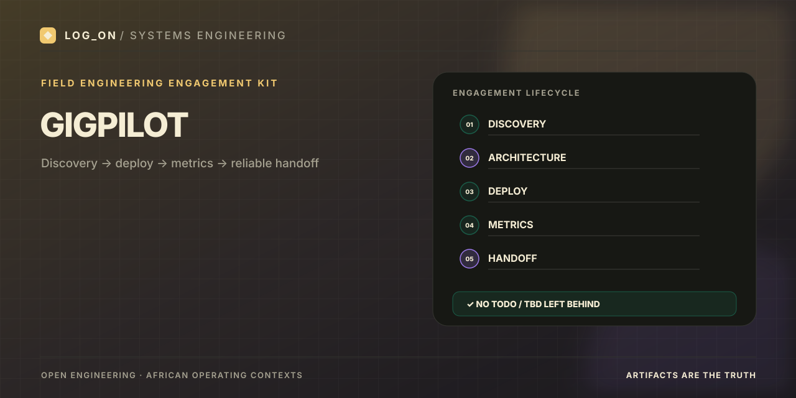

# GigPilot

<p align="center">
  
</p>

[]()
[]()

---

## What problem does this solve?

Technical systems ship without transferable engagement artifacts. Handoffs contain TODO/TBD. GigPilot enforces a consistent spine so a stranger can re-run smoke from the handoff alone.

## What is implemented

- Templates: discovery, architecture, deploy, metrics_table, timeline, handoff
- Filled examples for ArchAudit CCM and AgentBridge Africa
- `check_pack.py` (required files + no TODO/TBD)
- Lifecycle language matched to FDE playbooks

## Quick start

```bash
python scripts/check_pack.py
```

## Reproducible terminal demo

Run the example-pack validator from the repository root:

```bash
python scripts/check_pack.py
```

A successful run prints `all example packs OK`. The validator checks required files and flags TODO/TBD markers in the example packs. Run the command locally before recording; publish a success screenshot only if the validator actually passes.

For a short recording, use [asciinema](https://asciinema.org/) to capture `python scripts/check_pack.py`, then convert the cast to a compressed GIF with [agg](https://github.com/asciinema/agg). Review the output for readability before committing the GIF.

## Portfolio value

Delivery discipline and stakeholder-ready packaging for AI systems in African contexts.

## Limitations

Artifact kit only — runtime lives in the companion repositories.

## Companion repositories

- [ArchAudit-CCM](https://github.com/Logonotobscurity/ArchAudit-CCM)
- [AgentBridge-Africa](https://github.com/Logonotobscurity/AgentBridge-Africa)

## Visual assets

- Branded README banner: `docs/assets/social-preview.svg`.
- Repository social preview: upload the matching 1280×640 PNG through **Settings → General → Social preview**; this is separate from the README banner.
- Optional validator GIF: record locally, verify the real output, then commit a compressed GIF if useful.
